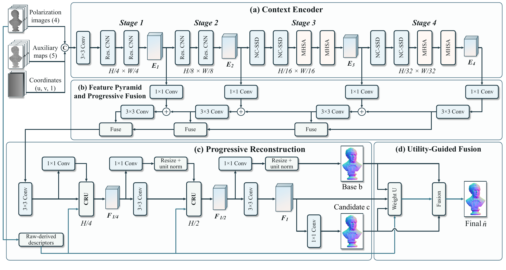

# CRUF-Net

**Conditional Reconstruction with Utility-Guided Fusion for Shape from Polarization**

Contact: [yexj@mails.neu.edu.cn](mailto:yexj@mails.neu.edu.cn)

[中文说明](README_zh-CN.md) | [Data preparation](docs/DATA_PREPARATION.md) | [Training and evaluation](docs/TRAINING.md) | [License](LICENSE)

CRUF-Net estimates surface normals from polarization observations. Its Conditional Reconstruction Unit (CRU) uses predicted geometry and observation descriptors to condition feature reconstruction. Utility-Guided Fusion (UGF) learns a pixel-wise blend of a base normal estimate and a fine candidate, supervised by their relative angular error during training.

This repository provides the model, training and evaluation scripts, dataset adapters, fixed split lists, and component ablations. Training starts from random initialization. Weights and datasets are not distributed.

## Motivation


**Figure 1.** Changing observations motivate conditional reconstruction and selective fusion of base and candidate normal estimates.

## Framework



**Figure 2.** Context encoding, feature pyramid fusion, progressive reconstruction, and utility-guided output fusion.

## Installation

Use Python 3.12 and run all commands from the repository root.

```bash
python -m venv .venv
```

Activate the environment on Linux:

```bash
source .venv/bin/activate
```

Or in Windows PowerShell:

```powershell
.venv\Scripts\Activate.ps1
```

Install PyTorch 2.8.0 and the remaining dependencies. The CUDA 12.8 build used for training is installed with:

```bash
python -m pip install torch==2.8.0 --index-url https://download.pytorch.org/whl/cu128
python -m pip install -r requirements.txt
```

For a CPU-only installation, replace the first command with:

```bash
python -m pip install torch==2.8.0 --index-url https://download.pytorch.org/whl/cpu
```

Other builds are listed in the [official PyTorch instructions](https://pytorch.org/get-started/previous-versions/#v280). Dependencies are PyTorch, NumPy, SciPy, and Pillow; no custom CUDA extension is required. Full training is intended for a CUDA GPU. Add `--device cpu` to training or evaluation commands for small CPU checks.

## Train and evaluate

Obtain the datasets from their authors and follow [Data preparation](docs/DATA_PREPARATION.md) for directory layouts, required fields, preprocessing, and input channels. The example paths below can be replaced with your local paths.

### MuS-Polar3D

```bash
python prepare_data.py --config configs/mus.json --mat-root data/MuS-Polar3D_Mat --pol-root data/MuS-Polar3D_Pol --cache prepared/mus
python train.py --config configs/mus.json --cache prepared/mus --output runs/mus_full
python evaluate.py --config configs/mus.json --cache prepared/mus --checkpoint runs/mus_full/best.pt --output results/mus_full --save-predictions
```

The supplied lists contain 570 training and 84 validation samples. Evaluation covers all six listed turbidity levels and reports both overall and per-level metrics. The overall result is the arithmetic mean of per-image metrics across the 84 images.

### DeepSfP

Use the development split for component experiments:

```bash
python prepare_data.py --config configs/deepsfp_development.json --data-root data/DeepSfPData --cache prepared/deepsfp
python train.py --config configs/deepsfp_development.json --cache prepared/deepsfp --output runs/deepsfp_development
python evaluate.py --config configs/deepsfp_development.json --cache prepared/deepsfp --checkpoint runs/deepsfp_development/best.pt --output results/deepsfp_development
```

For the final protocol, train on all 236 official training images for the configured 360 epochs and evaluate on the 21 official test images:

```bash
python prepare_data.py --config configs/deepsfp_final.json --data-root data/DeepSfPData --cache prepared/deepsfp --include-test
python train.py --config configs/deepsfp_final.json --cache prepared/deepsfp --output runs/deepsfp_final
python evaluate.py --config configs/deepsfp_final.json --cache prepared/deepsfp --checkpoint runs/deepsfp_final/final.pt --output results/deepsfp_final --save-predictions
```

### Resume

```bash
python train.py --config configs/mus.json --cache prepared/mus --output runs/mus_full --resume
```

Training resumes after the last completed epoch, restoring the optimizer, scheduler, and random states. Keep the configuration, prepared data, and model source unchanged. Use `--stop-after-epoch 1` for a controlled early stop without changing the configured learning-rate schedule.

### Component ablations

Choose `--variant` and a separate output directory:

```bash
python train.py --config configs/mus.json --cache prepared/mus --output runs/mus_no_cru --variant no_cru
python evaluate.py --config configs/mus.json --cache prepared/mus --checkpoint runs/mus_no_cru/best.pt --output results/mus_no_cru --variant no_cru
```

| Variant | CRU | Output | Utility supervision |
|---|---|---|---|
| `full` | Enabled | Learned blend | Enabled |
| `no_cru` | Disabled | Learned blend | Enabled |
| `no_ugf` | Enabled | Candidate | Disabled |
| `baseline` | Disabled | Candidate | Disabled |
| `fixed_blend` | Enabled | Equal blend | Disabled |
| `no_utility_loss` | Enabled | Learned blend | Disabled |

Use these variants with MuS or the DeepSfP development protocol. See [Training and evaluation](docs/TRAINING.md) for the loss terms, blending schedule, and exact interventions.

## Outputs

Training writes model files (`last.pt`, `final.pt`, and `best.pt` for validation-based runs), the configuration, environment information, history, and summary. These files are created by training and are excluded from version control.

Evaluation writes `metrics.json` and `per_image_metrics.csv`. With `--save-predictions`, it also exports compressed arrays containing predicted normals, reference normals, masks, observed mean intensity, base normals, candidate normals, and acceptance maps. Normal arrays use `3 × H × W`; masks and acceptance maps use `1 × H × W`. Choose a new output directory for each evaluation.

## Repository structure

```text
crufnet/          Model, layers, data adapters, losses, metrics, and runners
configs/          MuS and DeepSfP experiment configurations
splits/           Fixed sample lists and their integrity manifest
tests/            Forward/backward, fusion, metric, and split checks
docs/             Data and training instructions; Figures 1 and 2
prepare_data.py   Validate datasets and prepare caches
train.py          Train, resume, and run component ablations
evaluate.py       Evaluate and optionally export predictions
```

## Checks

```bash
python -m unittest discover -s tests -v
```

The tests exercise forward/backward computation, odd image sizes, unit-normal outputs, blending endpoints, utility-target detachment, tiled inference, masked metrics, and split integrity. They run on CPU without downloading data or weights.

## Citation

If you use this implementation in academic work, please cite the CRUF-Net manuscript. The citation is provided in [BibTeX format](CITATION.bib).

## License

The code is provided under [PolyForm Noncommercial 1.0.0](LICENSE). Noncommercial academic research, reproduction, and paper comparisons are permitted under its terms. Uses outside those permissions require separate authorization; contact [yexj@mails.neu.edu.cn](mailto:yexj@mails.neu.edu.cn). Retain the license and [required notice](NOTICE) when redistributing covered code.

This is a noncommercial source-available release. Third-party dependencies and datasets retain their own licenses and are obtained separately. Figures 1 and 2 are included only as documentation illustrations; no weights, datasets, or experimental outputs are included.
