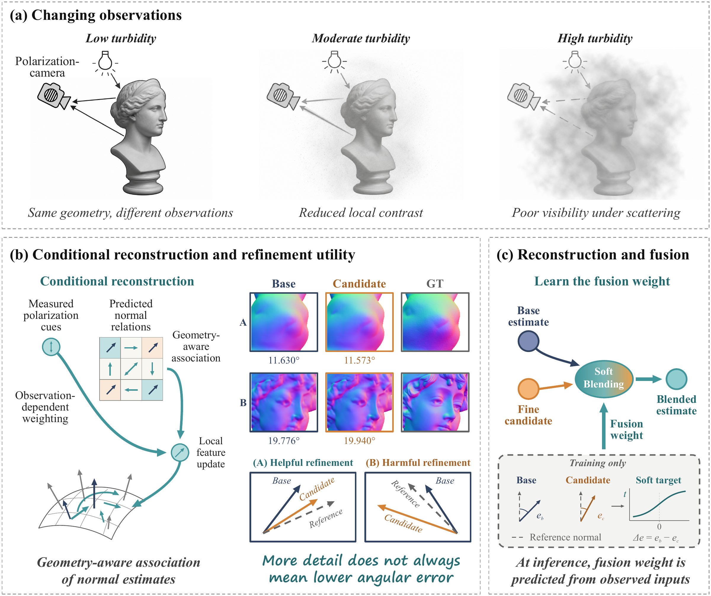
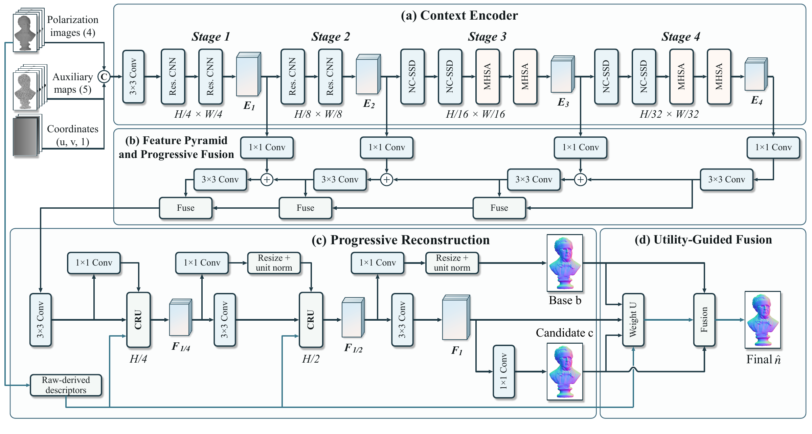

# CRUF-Net

**结合效用引导融合的偏振形状条件重建网络**

通讯邮箱：[yexj@mails.neu.edu.cn](mailto:yexj@mails.neu.edu.cn)

[English](README.md) | [数据准备](docs/DATA_PREPARATION.md) | [训练与评估](docs/TRAINING.md) | [许可证](LICENSE)

CRUF-Net 从偏振观测估计表面法向。条件重建单元（CRU）通过预测几何与观测描述子调节特征重建；效用引导融合（UGF）根据基础法向与精细候选之间的相对角度误差学习逐像素融合权重。

仓库提供网络实现、数据准备、训练、评估、固定数据划分和组件消融配置。模型从随机初始化开始训练，不提供权重和数据集。

## 研究动机与框架





## 安装

使用 Python 3.12，在仓库根目录执行命令。先创建并激活虚拟环境，再安装依赖：

```bash
python -m venv .venv
```

Linux 激活命令：

```bash
source .venv/bin/activate
```

Windows PowerShell 激活命令：

```powershell
.venv\Scripts\Activate.ps1
```

CUDA 12.8 环境：

```bash
python -m pip install torch==2.8.0 --index-url https://download.pytorch.org/whl/cu128
python -m pip install -r requirements.txt
```

只使用 CPU 时，将第一条安装命令的索引地址改为 `https://download.pytorch.org/whl/cpu`，并在训练或评估命令中添加 `--device cpu`。完整训练建议使用 CUDA GPU；本实现无需自定义 CUDA 扩展。

## MuS-Polar3D

从数据集作者处获取原始数据，按[数据准备说明](docs/DATA_PREPARATION.md)保留目录与字段。示例路径可以替换为自己的实际路径。

```bash
python prepare_data.py --config configs/mus.json --mat-root data/MuS-Polar3D_Mat --pol-root data/MuS-Polar3D_Pol --cache prepared/mus
python train.py --config configs/mus.json --cache prepared/mus --output runs/mus_full
python evaluate.py --config configs/mus.json --cache prepared/mus --checkpoint runs/mus_full/best.pt --output results/mus_full --save-predictions
```

固定划分包含 570 幅训练图像和 84 幅验证图像。评估覆盖列表中的六个浊度等级，总体指标为 84 幅图像各自指标的算术平均，同时导出分浊度结果。

## DeepSfP

开发集实验使用 `configs/deepsfp_development.json`，最终训练与官方测试使用 `configs/deepsfp_final.json`。最终协议命令如下：

```bash
python prepare_data.py --config configs/deepsfp_final.json --data-root data/DeepSfPData --cache prepared/deepsfp --include-test
python train.py --config configs/deepsfp_final.json --cache prepared/deepsfp --output runs/deepsfp_final
python evaluate.py --config configs/deepsfp_final.json --cache prepared/deepsfp --checkpoint runs/deepsfp_final/final.pt --output results/deepsfp_final --save-predictions
```

完整的开发集命令及消融选项见[英文 README](README.md)。两个数据集分别训练，其辅助输入由各自的数据适配器构造。

## 续训、结果与检查

在原训练命令末尾添加 `--resume` 可从最近完成的轮次续训；需保留原配置、数据缓存和模型源码。`--stop-after-epoch 1` 可用于短程检查，不会缩短配置中的学习率周期。

评估输出 `metrics.json` 和 `per_image_metrics.csv`。添加 `--save-predictions` 可导出法向、掩膜以及基础分支、候选分支和融合权重等数组。每次评估使用新的输出目录。

运行无需数据和权重的 CPU 检查：

```bash
python -m unittest discover -s tests -v
```

## 引用与许可

学术使用请引用 CRUF-Net 论文稿件，引用信息见 [BibTeX 文件](CITATION.bib)。

代码采用 [PolyForm Noncommercial 1.0.0](LICENSE)，支持其条款允许的非商业学术研究、复现与论文对比。超出许可范围的商业使用需另行取得授权，联系 `yexj@mails.neu.edu.cn`。再分发时请保留许可证和 [NOTICE](NOTICE)。

这是限制商用的源码公开版本。第三方依赖与数据集遵循各自许可，并由使用者另行获取。仓库仅附图 1、图 2 两张说明插图，不附带权重、数据集或实验输出。
